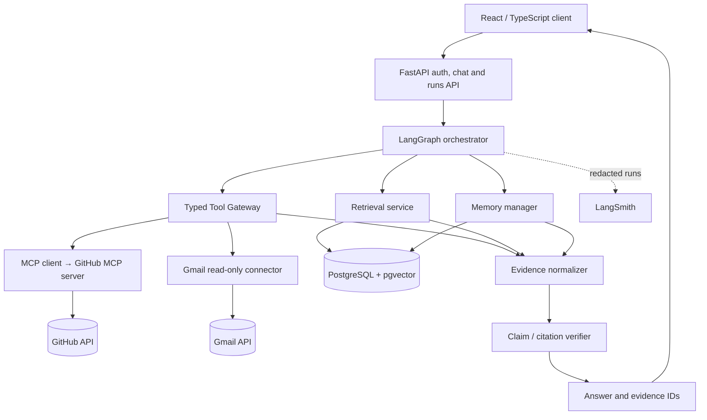

# 02 — System Architecture

> See `diagrams/system_architecture.svg` and the editable `.dot` source. This is a **target** architecture; Antigravity must mark what is built versus planned.

## Logical boundaries

### UI layer
- Web UI does not hold OAuth refresh tokens, provider secrets or database service credentials.
- API returns structured answer, citations, status and non-sensitive activity events.
- Citations open the original source URL or a protected evidence drawer if the original has no stable shareable URL.

### API layer
- Resolve active single-user identity and workspace. Scope every query by that identity; do not leave publicly writable endpoints.
- Route conversations, connections, memory, runs and source-sync requests separately.
- Validate input, impose budget limits and structured error responses.

### Agent layer
- Run constrained planning and source selection, not endless self-recursion.
- Enforce explicit tool allow-list, call caps and timeouts.
- Collect evidence with `source_type`, `external_id`, `url`, `title`, `observed_at`, `source_updated_at`, `connector_status`.
- Mark uncertain or conflicting evidence.

### Connector layer
- Real GitHub via custom MCP server/client implementation; transport documented and integration tested.
- Gmail: OAuth minimum read-only scope; never log tokens or raw personal email bodies.
- Credential storage encrypted or managed secrets; never localStorage, never source control.
- Implement pagination, retries, rate limits, delta sync / last modified where supported.

### Retrieval/storage
- Postgres remains source of truth for indexed metadata and app records.
- Embeddings support semantic *discovery*, not claims about exact current issue states.
- For open issue counts, current deadlines and statuses prefer direct source API, especially when a previously indexed record may be stale.
- Every chunk retains provenance to exact source and timestamp; handle deletions/reindexing.

### Observability
- Record user-safe summary of tool name, duration, result counts, source IDs and errors.
- LangSmith is optional when configured; redact sensitive content and opt out of tracing if confidentiality requires it.
- Never show raw internal chain-of-thought as an activity view.

## Freshness policy

| Question | Retrieval strategy | How to describe freshness |
| --- | --- | --- |
| "Which issues are open right now?" | Live GitHub API | "Checked GitHub at [timestamp]" |
| "What was decided in the planning email?" | Gmail authorized search / fetched message | Original email date + checked-at |
| "Where was a feature previously discussed?" | Indexed chunks + metadata, with refresh where needed | Last indexed, original updated-at |
| "What do I prefer?" | Durable memory | "Remembered preference" plus provenance |
| "What changed since yesterday?" | Compare stored snapshots and live updates | State comparison with observed times |

## Failure handling

- If GitHub fails but Gmail works, answer what Gmail supports and explicitly say GitHub is unavailable.
- If sources disagree on deadline, show both with update timestamps; do not silently pick one.
- If no evidence, abstain and propose what connection or document would be required.
- If a tool hits rate limits, surface retryable status and avoid repeating endlessly.

## Security boundary

Read-only retrieval is the only permitted external effect in v1. OAuth authorization is user-controlled. Tool results and retrieved message text are **untrusted data** and cannot change agent instructions.
