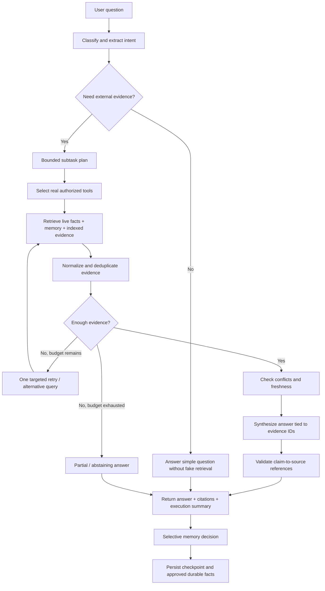

# 03 — Agent Workflow & Evidence Contract

> Editable diagram: `diagrams/agent_workflow.dot`; rendered SVG and PNG included.



## Planning schema (illustrative)

```json
{
  "intent": "find_blockers_and_priorities",
  "subtasks": [
    {"id": "issues", "goal": "fetch open blocking issues", "tool": "github.search_issues"},
    {"id": "comms", "goal": "find approvals and decisions", "tool": "gmail.search_messages"},
    {"id": "priority", "goal": "retrieve relevant long-term priority", "tool": "memory.search"}
  ],
  "allowed_max_tool_calls": 8
}
```

Tool names and schemas here are design contracts to implement, not claims of existing libraries.

## Evidence object contract

```json
{
  "evidence_id": "ev_github_alpha_42",
  "source_type": "github_issue",
  "external_id": "repo#42",
  "title": "Release build fails in CI",
  "url": "https://github.com/EXAMPLE_ORG/EXAMPLE_REPO/issues/42",
  "snippet": "Release pipeline failing on integration tests",
  "source_updated_at": "2026-10-25T10:00:00Z",
  "observed_at": "2026-10-26T08:00:00Z",
  "live_checked": true
}
```

Example URLs and data are synthetic and must never be rendered as actual citations in real mode.

## Final response structure

```json
{
  "answer": "One confirmed release blocker ... [ev_github_alpha_42]",
  "citations": [
    {"evidence_id": "ev_github_alpha_42", "label": "GitHub issue #42", "url": "..."}
  ],
  "source_status": [{"connector": "github", "status": "success"}],
  "activity": [{"name": "Search GitHub issues", "duration_ms": 410, "status": "success"}],
  "limitations": [],
  "run_id": "..."
}
```

## Citation verification

- Evidence IDs are assigned by trusted code during retrieval, **not** fabricated by the LLM.
- Final answers may cite only evidence IDs in the current run or explicit durable, source-backed memories.
- The API verifies every emitted citation ID exists and that referenced evidence belongs to the current workspace.
- If citation validation fails, repair the response once or remove unsupported claim; log the event.
- Do not conflate "model confident" with source quality; avoid manufactured confidence percentages.

## Controlling complexity

- One orchestrating agent with specialized tools is enough to start; no multi-agent swarm.
- Cap tool calls, concurrent requests, recursion and tokens; tune to evaluations.
- Short-circuit simple conversational queries.
- Prefer direct API calls for exact state and numeric counts.
- Explain how partial answers and conflicting facts appear in UI.
