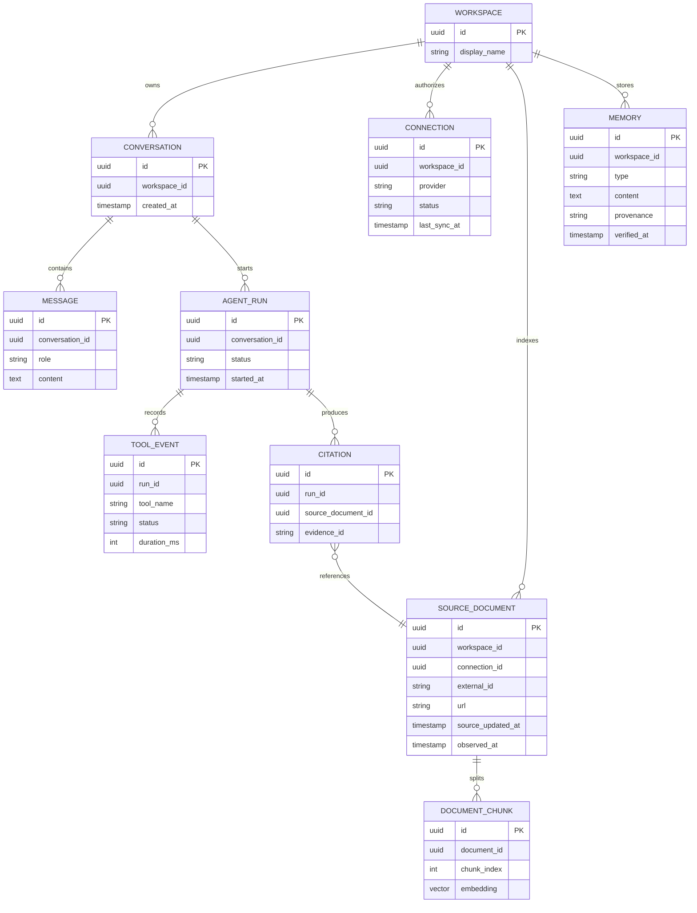
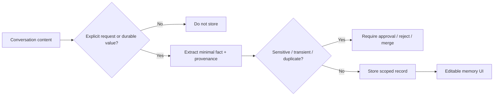

# 04 — Data Model & Memory Specification

> See `diagrams/data_memory_erd.svg` and the editable Graphviz source.

The ERD is a **logical model**; choose normalised, migration-managed physical columns and suitable indexes. Real implementations may need additional tables for connector cursors, credential references, checkpoints and evidence snapshots.

## Two memory tiers

| Tier | Scope | Storage | Use | Example |
| --- | --- | --- | --- | --- |
| Short-term | One thread | Persistent LangGraph checkpointer | Conversation continuity / resume | "It" means Project Alpha in follow-up |
| Long-term | Across threads | Scoped memory records / LangGraph store backed by Postgres | Durable preferences and priorities | "Alpha is the top priority" |

LangGraph docs distinguish checkpointers from stores. Use persistent implementations rather than in-memory-only stores for the real app.

## Long-term memory categories

- **Explicit user memory** — user says remember X; write with provenance and allow edit/delete.
- **Stable preference** — format/tone/priority preference, only when durable and useful.
- **Time-bound project context** — fact with expiry or verification date; never silently treated as current after becoming stale.
- **Episodic summary** — compact, user-relevant previous decision/action outcome; avoid duplicating whole chat.

## Write decision

## Conflict handling

- Source-of-truth ordering depends on fact type: current issue state → current GitHub API; personal preference → user-confirmed durable memory.
- For deadlines from Gmail vs GitHub, display conflict and timestamps rather than inventing priority.
- Include fields such as `valid_until`, `source_updated_at`, `last_verified_at`, and `superseded_by` if relevant.
- Deleting a memory removes it from user-facing retrieval. Check how checkpoints/snapshots/backups are handled and document retention precisely.

## Privacy model

- Connection secrets encrypted or held by the hosting secret manager; DB only credential references where possible.
- Never expose tokens in client APIs, telemetry or logs.
- Isolate document, chunk, memory, conversation and citation retrieval by workspace.
- Multi-user permissions, real tenant isolation and audited access remain separate future acceptance criteria.
